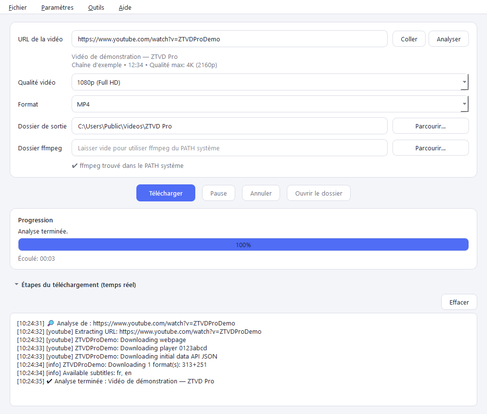
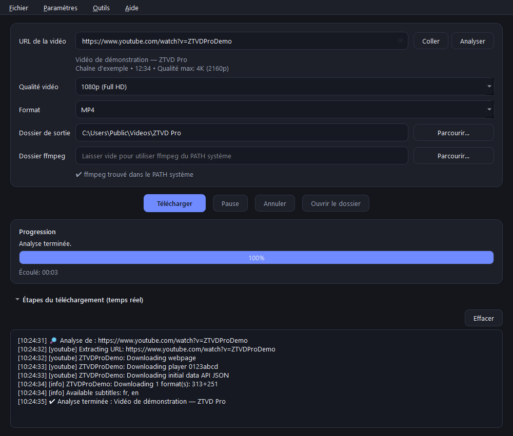

# ZTVD Pro

[](https://github.com/ZAGHTN/ZTVDPro/actions/workflows/ci.yml)
[](LICENSE)
[](pyproject.toml)
[](#compiled-version-end-users)

Cross-platform desktop application (Windows, macOS, Linux) for downloading videos
from popular sites at the best available video and audio quality.

- Engine: [yt-dlp](https://github.com/yt-dlp/yt-dlp) + [ffmpeg](https://ffmpeg.org)
- UI: **PySide6** (Qt 6), **light / dark** themes
- Languages: **English, French, Arabic** (automatic right-to-left layout)
- License: **GPL-3.0-only**



<details>
<summary>Dark theme</summary>



</details>

> The full, authoritative documentation is in French in [`README.md`](README.md).

## Download

Compiled builds are published on the
[**GitHub Releases**](https://github.com/ZAGHTN/ZTVDPro/releases) page. The Windows
archive contains the complete `ZTVDPro\` folder (application, ffmpeg, EJS solver
and Deno):

1. download `ZTVDPro-<version>-win64.zip`;
2. extract the archive;
3. run `ZTVDPro.exe` from the extracted folder.

Do not move the executable alone: ffmpeg and the other components must stay next
to it. The archive SHA-256 is published in the release notes. The zip is about
275 MB; the extracted folder is about 663 MB (ffmpeg + ffprobe ≈ 416 MB,
Deno ≈ 93 MB, Qt and application ≈ 150 MB).

> Large binaries are not committed to Git history. They are attached to releases
> (2 GB per asset limit) instead of being pushed to the repository (100 MB per
> file limit).

## Features

- URL field with **Paste** and **Analyze** buttons.
- **Pre-download analysis**: animated progress bar, elapsed time and live yt-dlp
  steps. Shows title, channel, duration and maximum available quality; higher
  qualities are disabled in the list.
- Video quality: best available, 8K, 4K, 1440p, 1080p, 720p, SD (480p / 360p /
  240p / 144p).
- Formats: MP4, MKV, WEBM, MOV, AVI, MP3 (audio only, 320 kbps).
- **Automatic WEBM → MKV fallback** when a WEBM merge fails.
- Selectable output folder and ffmpeg folder (automatic detection, then system
  `PATH`).
- Real-time progress: percentage, speed, ETA, size.
- Collapsible download-steps section with the yt-dlp log.
- **Pause / Resume** (HTTP `Range`, `.part` files) and **Cancel**.
- **Open folder** button, enabled after a successful download.
- Dynamic window title during downloads: `42% Video title` (`⏸` when paused).
- Safe shutdown: cooperative thread cancellation, never `QThread.terminate()`.
- Language, theme, yt-dlp update, startup update check and About menus.
- Settings persisted with `QSettings` and validated on load.
- Multi-resolution icon, bundled resources and rotating log file.

### Supported sites in URL validation

The built-in validation accepts `http(s)` URLs from **YouTube**
(`youtube.com`, `youtu.be`), **Facebook** (`facebook.com`) and **Dailymotion**
(`dailymotion.com`), including subdomains. yt-dlp supports many more sites, but
they must be added to `SUPPORTED_DOMAINS` in `app/downloader.py` to be accepted
by the UI.

## Installation from source

Requirements: **Python 3.11+**, **ffmpeg** (with ffprobe) and, for recent YouTube
formats, **Deno 2.9.8+** (recommended) or Node.js.

```bash
python -m venv .venv
source .venv/bin/activate        # Windows: .venv\Scripts\activate
pip install -r requirements.txt
python main.py
```

For development and tests:

```bash
pip install -r requirements-dev.txt
```

### Install ffmpeg

| System | Command / source |
|---|---|
| Windows | Download a build from <https://www.gyan.dev/ffmpeg/builds/>, extract it, then select its `bin` folder in the app |
| macOS | `brew install ffmpeg` |
| Debian/Ubuntu | `sudo apt install ffmpeg` |

If ffmpeg is on `PATH`, leave the "ffmpeg folder" field empty.

## Compiled version (end users)

A build produced with `ZTVDPro.spec` requires **no yt-dlp configuration**: the
EJS solver (`yt-dlp-ejs`) and, when included at build time, Deno are bundled.
The `ejs:github` fallback is already enabled in the code.

| Situation | User action |
|---|---|
| Official build (solver + Deno bundled) | **Nothing to do** |
| Build with `-NoDeno`, or Deno missing at build time | Install **Deno 2.9.8+** (recommended) or **Node.js**, then restart the app |
| GitHub blocked by a proxy / firewall | Nothing if the solver is bundled; otherwise allow `github.com` |
| Offline machine | Downloads still work; some recent formats may be missing without a bundled solver |

### JavaScript runtime (only when Deno is not bundled)

```powershell
winget install DenoLand.Deno
deno --version   # 2.9.8 or newer recommended
# or
winget install OpenJS.NodeJS.LTS
node --version
```

Detection order: **bundled Deno**, **Deno on `PATH`**, then **Node.js on `PATH`**.

## Usage

1. Paste the video URL and click **Analyze** to see info and available qualities.
2. Choose quality and format.
3. Check the output folder and ffmpeg status (✔ / ✘ below the field).
4. Click **Download**. Expand "Download steps" for live details.

## Pause and resume

- **Pause** stops the transfer and keeps `.part` files in the output folder.
- **Resume** continues from the last byte (HTTP `Range` requests).
- Pause is disabled during the ffmpeg merge/conversion phase.
- **Cancel** during a pause resets the app; partial files remain on disk.
- Quitting during a pause cancels the download after confirmation; starting the
  same download later resumes from the `.part` files.

## Updating yt-dlp

Menu **Tools → Update yt-dlp…**:

- **source version** (`python main.py`): runs `pip install --upgrade yt-dlp` in
  the background;
- **compiled version**: downloads the official `yt-dlp` and `yt-dlp-ejs` wheels
  from PyPI, verifies their SHA-256 and installs them in
  `%LOCALAPPDATA%\ZTVDPro\ytdlp\current`. No administrator rights are required
  and `dist\ZTVDPro\` is not modified.

Restart the app afterwards. If the downloaded version is missing, older or
invalid, the bundled version is used automatically. **Tools → Remove downloaded
yt-dlp (bundled version)** rolls back.

> The compiled version uses neither `pip` nor a system Python: updates are
> limited to the pure-Python `yt-dlp`/`yt-dlp-ejs` packages. Optional binary
> dependencies (e.g. `curl_cffi`) remain those of the build.

## Robustness

- **Cooperative thread shutdown**: cancellation is requested and the worker is
  awaited (15 s download, 10 s analysis, 5 s update); `QThread.terminate()` is
  never used.
- **Workers are released** with `deleteLater()` after completion.
- **Consistent UI across language changes**: quality/format lists are rebuilt
  without re-enabling fields locked during analysis or download.
- **Reliable settings**: corrupted `QSettings` values fall back to defaults.
- **WEBM → MKV fallback**: one retry only, and never after a cancellation or a
  network error.

## Quality notes

- Video and audio streams are downloaded separately (`bv*+ba`) and **merged
  without re-encoding**.
- MP4 / MOV / AVI prefer H.264 + AAC. In 4K/8K, sites often only provide
  VP9/AV1; the video is then kept as-is (MKV or WEBM recommended).
- AVI is the only format that requires an ffmpeg **conversion**; MP4, MOV and MKV
  are produced by lossless merge/remux.
- WEBM only accepts VP9/AV1 + Opus/Vorbis; otherwise the app automatically
  retries as MKV.
- The official EJS solver is preferred, with `ejs:github` as fallback.
  **Deno 2.9.8+** (recommended) or Node.js is required unless Deno is bundled.

## Documentation

| Document | Content |
|---|---|
| [`docs/BUILD.md`](docs/BUILD.md) | Reference versions, ffmpeg hashes, reproducible build and release |
| [`CHANGELOG.md`](CHANGELOG.md) | Version history |
| [`THIRD_PARTY_NOTICES.md`](THIRD_PARTY_NOTICES.md) | Third-party licenses |
| [`CONTRIBUTING.md`](CONTRIBUTING.md) | Development setup and contribution rules |
| [`SECURITY.md`](SECURITY.md) | Vulnerability reporting |
| [`CODE_OF_CONDUCT.md`](CODE_OF_CONDUCT.md) | Code of conduct |

## Project layout

```text
main.py                 entry point
ZTVDPro.spec            PyInstaller configuration
build.ps1               Windows build script
pyproject.toml          metadata, pinned dependencies, pytest config
requirements.txt        runtime dependencies (including yt-dlp-ejs)
requirements-dev.txt    development dependencies (pytest, PyInstaller, flake8)
app/                    application package (UI, downloader, updater, i18n, themes)
assets/                 PNG / ICO icon
docs/                   build guide and README screenshots
licenses/               third-party license texts
tests/                  unit tests
tools/                  reproducible icon and screenshot generation
src/ffmpeg/bin/         ffmpeg.exe and ffprobe.exe (not versioned)
```

Logs are written to `%LOCALAPPDATA%\ZTVDPro\logs\ztvd_pro.log` (Windows),
`~/Library/Logs/ZTVDPro/` (macOS) or `~/.local/state/ztvdpro/logs/` (Linux), with
automatic rotation. No log file is created in the current directory.

## Tests

```bash
pip install -r requirements-dev.txt
.venv/Scripts/python.exe -m pytest
# or
.venv/Scripts/python.exe tests/run_tests.py
```

On macOS/Linux, use `.venv/bin/python` instead of `.venv/Scripts/python.exe`.

CI runs on Ubuntu and Windows with Python 3.11 and 3.13:

```bash
python -m flake8 . --count --select=E9,F63,F7,F82 --show-source --statistics
python -m flake8 . --count --exit-zero --max-complexity=10 --max-line-length=127 --statistics
QT_QPA_PLATFORM=offscreen python -m pytest -q
```

The suite contains **82 tests**. Qt tests use `QT_QPA_PLATFORM=offscreen`
(see `tests/conftest.py`).

## Build a Windows executable

`ZTVDPro.spec` produces a self-contained `dist\ZTVDPro\` folder containing
`ZTVDPro.exe`, ffmpeg/ffprobe, the EJS solver, the icon and, when available, Deno.
`ffplay.exe` is not bundled.

Requirements:

- Python **3.11+**;
- `src\ffmpeg\bin\ffmpeg.exe` and `src\ffmpeg\bin\ffprobe.exe`;
- PyInstaller (`pip install -r requirements-dev.txt`);
- Deno on `PATH`, or in `src\deno\deno.exe` / `src\deno\bin\deno.exe`
  (optional, **2.9.8+** recommended).

```powershell
.\build.ps1
```

Without Deno:

```powershell
.\build.ps1 -NoDeno
```

Manual equivalent:

```powershell
.venv\Scripts\python.exe -m PyInstaller --noconfirm --clean ZTVDPro.spec
```

**Always distribute the complete `dist\ZTVDPro\` folder**, never the executable
alone. The folder is about 660 MB. See [`docs/BUILD.md`](docs/BUILD.md) for
reference versions, SHA-256 hashes, release archive creation and optional
Windows code signing.

macOS/Linux: use `ZTVDPro.spec` as a starting point with `pyinstaller`, adapting
the ffmpeg executable names (without `.exe`).

## Contributing

Contributions (fixes, translations, documentation, tests) are welcome. Read
[`CONTRIBUTING.md`](CONTRIBUTING.md) and [`CODE_OF_CONDUCT.md`](CODE_OF_CONDUCT.md)
before opening an issue or pull request.

- Bugs: [issue template](https://github.com/ZAGHTN/ZTVDPro/issues/new?template=bug_report.yml)
- Features: [issue template](https://github.com/ZAGHTN/ZTVDPro/issues/new?template=feature_request.yml)
- Vulnerabilities: **do not** open a public issue, see [`SECURITY.md`](SECURITY.md)
- Questions: [Discussions](https://github.com/ZAGHTN/ZTVDPro/discussions)

## License

ZTVD Pro is distributed under the **GNU General Public License v3.0 only**
(`GPL-3.0-only`). The full text is in [`LICENSE`](LICENSE).

This license is required in particular by the bundled **GPLv3** ffmpeg build
(`--enable-gpl --enable-version3`). Third-party components keep their respective
licenses; see [`THIRD_PARTY_NOTICES.md`](THIRD_PARTY_NOTICES.md) and the
[`licenses/`](licenses/) folder.

By contributing, you agree that your contribution is distributed under the same
license.

## Legal notice

Only download content you own or that is licensed for download, and respect the
terms of service of the relevant sites.
