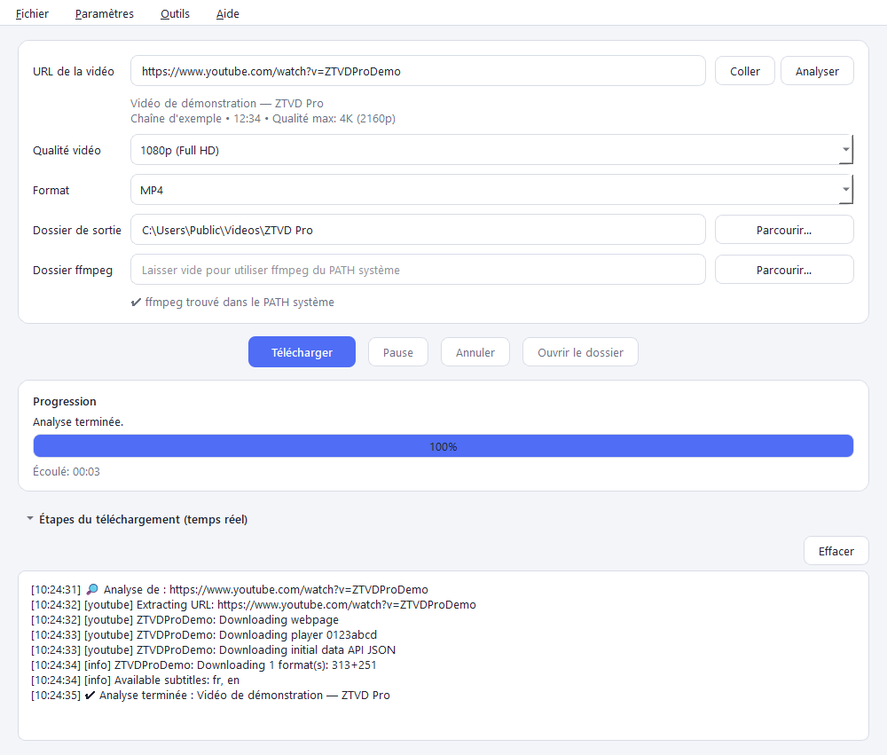
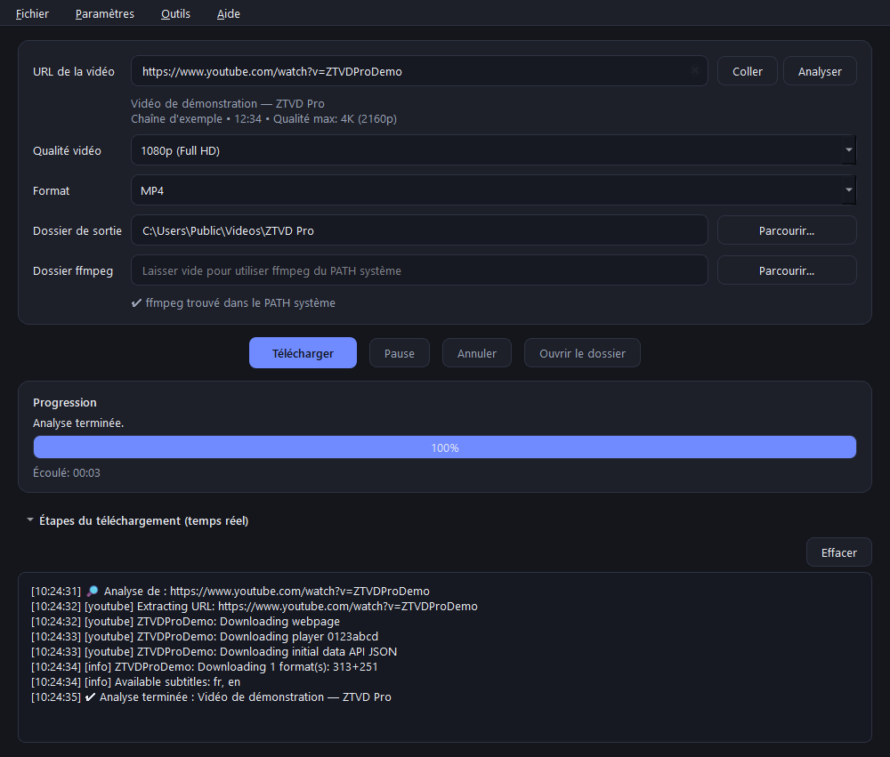

# ZTVD Pro

[](https://github.com/ZAGHTN/ZTVDPro/actions/workflows/ci.yml)
[](LICENSE)
[](pyproject.toml)
[](#version-compil%C3%A9e-utilisateur-final)

Application de bureau **multiplateforme** (Windows, macOS, Linux) pour télécharger des vidéos
depuis les sites les plus populaires, avec la meilleure qualité image et son possible.

- Moteur : [yt-dlp](https://github.com/yt-dlp/yt-dlp) + [ffmpeg](https://ffmpeg.org)
- Interface : **PySide6** (Qt 6), thèmes **clair / sombre**
- Langues : **English, Français, العربية** (avec bascule automatique en mode droite-à-gauche)
- Licence : **GPL-3.0-only**



<details>
<summary>Thème sombre</summary>



</details>

## Télécharger

Les versions compilées sont publiées dans les
[**Releases GitHub**](https://github.com/ZAGHTN/ZTVDPro/releases). L'archive Windows
contient le dossier complet `ZTVDPro\` (application, ffmpeg, solveur EJS et Deno) :

1. téléchargez `ZTVDPro-<version>-win64.zip` ;
2. extrayez l'archive ;
3. lancez `ZTVDPro.exe` depuis le dossier extrait.

Ne déplacez pas l'exécutable seul : ffmpeg et les autres composants doivent rester à côté.
Le SHA-256 de l'archive est publié dans les notes de release. La taille du zip est
d'environ 275 Mo ; le dossier extrait occupe environ 663 Mo (ffmpeg + ffprobe
≈ 416 Mo, Deno ≈ 93 Mo, Qt et application ≈ 150 Mo).

> Les binaires lourds ne sont pas versionnés dans le dépôt Git : ils sont joints aux
> releases (limite de 2 Go par asset) et non poussés dans l'historique Git
> (limite de 100 Mo par fichier).

## Fonctionnalités

- Champ URL (avec boutons *Coller* et *Analyser*)
- **Analyse de l'URL avant téléchargement** : barre d'avancement animée, temps écoulé et étapes de yt-dlp en direct
  (statut + journal). Le résultat affiche le titre, la chaîne, la durée et la qualité maximale disponible ;
  les qualités supérieures sont alors grisées dans la liste (votre choix est restauré si l'URL change)
- Qualité vidéo : meilleure disponible, 8K, 4K, 1440p, 1080p, 720p, SD (480p / 360p / 240p / 144p)
- Formats : MP4, MKV, WEBM, MOV, AVI, MP3 (audio seul, 320 kbps)
- **Repli automatique WEBM → MKV** : si la fusion WEBM échoue (site sans flux VP9/AV1 + Opus),
  le téléchargement est retenté une seule fois en MKV, qui accepte quasiment tous les codecs
- Dossier de sortie et dossier ffmpeg sélectionnables (détection automatique, sinon `PATH` système)
- Progression en temps réel : pourcentage, vitesse, temps restant, taille
- Section **repliable** des étapes du téléchargement (flux téléchargés, fusion, conversion, sortie yt-dlp)
- Boutons **Pause / Reprendre** et **Annuler**
- Bouton **Ouvrir le dossier** : désactivé tant qu'aucun téléchargement n'est terminé avec succès ; ouvre ensuite le
  dossier de sortie (et sélectionne le fichier sous Windows et macOS)
- Bouton **Effacer** dans la section des étapes pour vider le journal en temps réel
- Titre de la fenêtre dynamique pendant un téléchargement : `42% Titre de la vidéo` (`⏸` en pause)
- Fermeture sécurisée : confirmation si un téléchargement est actif ou en pause, blocage pendant une mise à jour de yt-dlp,
  arrêt coopératif des threads (jamais de `terminate()`)
- Menus : langue, thème, mise à jour de yt-dlp, vérification automatique au démarrage, à propos
- Réglages mémorisés entre les sessions (`QSettings`), validés et bornés à la lecture
- Icône multi-résolutions, ressources embarquées et journalisation rotative dans le dossier utilisateur

### Sites reconnus par la validation

La validation intégrée accepte les URL `http(s)` de **YouTube** (`youtube.com`, `youtu.be`),
**Facebook** (`facebook.com`) et **Dailymotion** (`dailymotion.com`), sous-domaines compris.
yt-dlp gère beaucoup d'autres sites, mais ils doivent être ajoutés à `SUPPORTED_DOMAINS`
dans `app/downloader.py` pour être acceptés par l'interface.

## Installation

Prérequis : **Python 3.11+**, **ffmpeg** (avec ffprobe) et, pour les formats YouTube récents,
**Deno 2.9.8+** (recommandé) ou Node.js.

```bash
python -m venv .venv
source .venv/bin/activate        # Windows : .venv\Scripts\activate
pip install -r requirements.txt
python main.py
```

Pour développer et lancer les tests :

```bash
pip install -r requirements-dev.txt
```

### Installer ffmpeg

| Système | Commande / source |
|---|---|
| Windows | Télécharger un build sur <https://www.gyan.dev/ffmpeg/builds/>, extraire, puis sélectionner le dossier `bin` dans l'application |
| macOS | `brew install ffmpeg` |
| Debian/Ubuntu | `sudo apt install ffmpeg` |

Si ffmpeg est dans le `PATH`, laissez le champ « Dossier ffmpeg » vide.

## Version compilée (utilisateur final)

Une version compilée avec `ZTVDPro.spec` ne demande **aucune configuration de yt-dlp** :
le solveur EJS (`yt-dlp-ejs`) et, si le build l'a inclus, Deno sont embarqués.
L'option `ejs:github` est déjà intégrée au code : l'utilisateur ne doit jamais la saisir.

| Situation | Action de l'utilisateur |
|---|---|
| Build officiel (solveur + Deno embarqués) | **Rien à faire** |
| Build avec `-NoDeno`, ou Deno absent au moment du build | Installer **Deno 2.9.8+** (recommandé) ou **Node.js**, puis redémarrer l'application |
| GitHub bloqué par un proxy / pare-feu | Rien si le solveur est embarqué ; sinon autoriser `github.com` |
| Machine hors ligne | Les téléchargements restent possibles ; sans solveur embarqué, certains formats récents peuvent manquer |

### Runtime JavaScript (uniquement si Deno n'est pas embarqué)

```powershell
winget install DenoLand.Deno
deno --version   # 2.9.8 ou plus récent recommandé
# ou
winget install OpenJS.NodeJS.LTS
node --version
```

L'application détecte dans cet ordre : **Deno embarqué**, **Deno du `PATH`**, puis
**Node.js du `PATH`**. Aucun chemin n'est à saisir dans l'interface.

### À propos de `ejs:github`

`ejs:github` autorise yt-dlp à télécharger le solveur officiel depuis le dépôt
[yt-dlp/ejs](https://github.com/yt-dlp/ejs) si aucun solveur local n'est disponible.
Dans la version compilée fournie, le paquet `yt-dlp-ejs` est embarqué : le solveur
est donc disponible immédiatement, sans accès GitHub. `ejs:github` reste activé
comme solution de repli.

## Utilisation

1. Collez l'URL de la vidéo : cliquez sur **Analyser** pour voir les infos et les qualités disponibles.
2. Choisissez la qualité et le format.
3. Vérifiez le dossier de sortie et l'état de ffmpeg (message ✔ / ✘ sous le champ).
4. Cliquez sur **Télécharger**. Dépliez « Étapes du téléchargement » pour le détail en direct.

## Pause et reprise

- **Pause** interrompt le transfert et conserve les fichiers partiels (`.part`) dans le dossier de sortie.
- **Reprendre** relance le même téléchargement : yt-dlp repart à l'octet où il s'était arrêté (requêtes HTTP `Range`)
  et ne retélécharge pas ce qui existe déjà. Les paramètres (URL, qualité, format, dossiers) sont verrouillés pendant la pause.
- La pause est désactivée pendant la phase ffmpeg (fusion / conversion), qui ne peut pas être suspendue.
- **Annuler** pendant une pause remet l'application à zéro ; les fichiers partiels restent sur le disque.
- Si vous quittez l'application pendant une pause, le téléchargement est annulé (après confirmation) ;
  relancer le même téléchargement plus tard le reprendra tout de même grâce aux fichiers `.part`.

## Mise à jour de yt-dlp

Les sites changent souvent : yt-dlp doit rester à jour. Menu **Outils → Mettre à jour yt-dlp…** :
l'application compare la version utilisée à celle de PyPI puis :

- **version source** (`python main.py`) : exécute `pip install --upgrade yt-dlp` en arrière-plan ;
- **version compilée** : télécharge les wheels officielles `yt-dlp` et `yt-dlp-ejs` depuis PyPI,
  vérifie leur empreinte SHA-256 et les installe dans `%LOCALAPPDATA%\ZTVDPro\ytdlp\current`.
  Aucun droit administrateur n'est nécessaire et le dossier `dist\ZTVDPro\` n'est pas modifié.

**Redémarrez l'application** ensuite. Au démarrage suivant, la version téléchargée est chargée en
priorité ; si elle est absente, plus ancienne ou invalide, la version intégrée reprend
automatiquement. Le menu **Outils → Supprimer le yt-dlp téléchargé (version intégrée)** permet de
revenir à la version embarquée, par exemple après une régression.

> La version compilée n'utilise ni `pip` ni Python système : la mise à jour se limite aux paquets
> Python purs `yt-dlp`/`yt-dlp-ejs`. Les dépendances binaires optionnelles (ex. `curl_cffi`)
> restent celles du build.

## Robustesse

- **Arrêt coopératif des threads** : à la fermeture, l'application demande l'annulation, attend
  la fin du worker (15 s pour un téléchargement, 10 s pour une analyse, 5 s pour une mise à jour)
  et ne force **jamais** l'arrêt. `QThread.terminate()` n'est plus utilisé : il pouvait corrompre
  les fichiers `.part` et faire planter Qt. Un thread qui ne répond pas à temps reste en arrière-plan
  jusqu'à sa fin réelle, puis est détruit.
- **Workers libérés** : les objets de téléchargement et d'analyse terminés sont détruits
  (`deleteLater()`), sans accumulation après des pauses/reprises répétées.
- **Interface cohérente pendant un changement de langue** : les listes de qualité et de format
  sont reconstruites sans réactiver des champs normalement verrouillés pendant une analyse ou un
  téléchargement. La qualité reste aussi grisée en mode MP3.
- **Réglages fiables** : les valeurs `format_idx` et `quality_idx` de `QSettings` sont validées et
  bornées. Un fichier de réglages corrompu retombe sur les valeurs par défaut au lieu de faire
  échouer le démarrage.
- **Repli WEBM → MKV** : si la fusion WEBM échoue, un unique nouvel essai est effectué en MKV.
  Une annulation ou une erreur réseau ne déclenche pas de nouvelle tentative.

## Notes sur la qualité

- Flux vidéo et audio sont téléchargés séparément (`bv*+ba`) puis **fusionnés sans ré-encodage**.
- MP4 / MOV / AVI : préférence H.264 + AAC (compatibilité maximale). En 4K/8K, les sites
  ne proposent souvent que VP9/AV1 : la vidéo est alors conservée telle quelle (MKV ou WEBM recommandés).
- AVI est le seul format qui impose une **conversion** (ré-encodage) par ffmpeg ; MP4, MOV et MKV sont
  produits par fusion/remux sans perte.
- WEBM n'accepte que VP9/AV1 + Opus/Vorbis : si le site ne propose rien de compatible, la fusion
  échoue et l'application retente automatiquement en MKV, qui accepte quasiment tous les codecs.
- **Solveur JavaScript YouTube** : le solveur officiel EJS (`yt-dlp-ejs`) est utilisé en priorité,
  et `ejs:github` reste autorisé en repli. Un interpréteur JavaScript (**Deno 2.9.8+** recommandé,
  ou Node.js) doit être disponible, sauf dans un build qui embarque Deno ; sans runtime, certains
  formats récents peuvent manquer.
- Certains sites (YouTube notamment) peuvent exiger un interpréteur JavaScript externe
  (par ex. Deno) pour yt-dlp : voir le wiki de yt-dlp en cas d'erreur de formats.

## Documentation

| Document | Contenu |
|---|---|
| [`docs/BUILD.md`](docs/BUILD.md) | Versions de référence, empreintes ffmpeg, build reproductible et release |
| [`CHANGELOG.md`](CHANGELOG.md) | Historique des versions |
| [`THIRD_PARTY_NOTICES.md`](THIRD_PARTY_NOTICES.md) | Licences des composants tiers |
| [`CONTRIBUTING.md`](CONTRIBUTING.md) | Environnement de développement et règles de contribution |
| [`SECURITY.md`](SECURITY.md) | Signalement des vulnérabilités |
| [`CODE_OF_CONDUCT.md`](CODE_OF_CONDUCT.md) | Code de conduite |

## Structure du projet

```text
main.py                 point d'entrée
ZTVDPro.spec            configuration PyInstaller
build.ps1               script de compilation Windows
pyproject.toml          métadonnées, dépendances épinglées, configuration pytest
requirements.txt        dépendances d'exécution (dont le solveur yt-dlp-ejs)
requirements-dev.txt    dépendances de développement (pytest, PyInstaller, flake8)
app/
  config.py             qualités, formats, détection ffmpeg
  i18n.py               traductions EN / FR / AR
  themes.py             thèmes clair / sombre
  downloader.py         QThread autour de yt-dlp, validation d'URL et exceptions
  logger.py             journalisation rotative dans le dossier utilisateur
  resources.py          accès aux ressources embarquées (icône)
  updater.py            vérification PyPI, mise à jour pip ou wheels utilisateur
  ytdlp_runtime.py      surcharge yt-dlp dans %LOCALAPPDATA% (version compilée)
  widgets.py            section repliable
  system.py             ouverture du dossier dans le gestionnaire de fichiers
  main_window.py        interface principale
assets/                 icône PNG / ICO
docs/
  BUILD.md              guide de build et de release
  screenshots/          captures d'écran du README
licenses/               textes des licences tierces
tests/                  tests unitaires (config, i18n, downloader, logger, updater, interface)
tools/                  génération reproductible de l'icône et des captures
src/
  ffmpeg/
    bin/                ffmpeg.exe et ffprobe.exe (non versionnés)
```

Les journaux sont écrits dans `%LOCALAPPDATA%\ZTVDPro\logs\ztvd_pro.log` (Windows),
`~/Library/Logs/ZTVDPro/` (macOS) ou `~/.local/state/ztvdpro/logs/` (Linux), avec rotation
automatique. Aucun fichier de log n'est créé dans le répertoire courant.

## Lancer les tests

```bash
pip install -r requirements-dev.txt
.venv/Scripts/python.exe -m pytest
# ou
.venv/Scripts/python.exe tests/run_tests.py
```

Sur macOS/Linux, remplacez `.venv/Scripts/python.exe` par `.venv/bin/python`.

Vérifications exécutées par la CI (Ubuntu et Windows, Python 3.11 et 3.13) :

```bash
python -m flake8 . --count --select=E9,F63,F7,F82 --show-source --statistics
python -m flake8 . --count --exit-zero --max-complexity=10 --max-line-length=127 --statistics
QT_QPA_PLATFORM=offscreen python -m pytest -q
```

La suite compte **82 tests**. Les tests Qt utilisent `QT_QPA_PLATFORM=offscreen`
(voir `tests/conftest.py`).

## Créer un exécutable (Windows)

La configuration PyInstaller fournie (`ZTVDPro.spec`) produit un dossier autonome
`dist\ZTVDPro\` contenant `ZTVDPro.exe`, ffmpeg/ffprobe, le solveur EJS, l'icône et, si
disponible, Deno. `ffplay.exe` n'est pas embarqué (inutile et ~220 Mo).

Prérequis :

- Python **3.11+** ;
- `src\ffmpeg\bin\ffmpeg.exe` et `src\ffmpeg\bin\ffprobe.exe` ;
- PyInstaller : `pip install -r requirements-dev.txt` ;
- Deno dans le `PATH`, **ou** déposé dans `src\deno\deno.exe` / `src\deno\bin\deno.exe`,
  pour l'embarquer (facultatif, **2.9.8+** recommandé).

```powershell
.\build.ps1
```

Pour compiler **sans installer Deno**, déposez simplement le binaire ici :

```text
src\deno\deno.exe
```

Le build le détecte automatiquement. Ce dossier est ignoré par Git (binaire volumineux).

Pour ne pas embarquer Deno (l'utilisateur devra l'installer) :

```powershell
.\build.ps1 -NoDeno
```

Équivalent manuel :

```powershell
.venv\Scripts\python.exe -m PyInstaller --noconfirm --clean ZTVDPro.spec
```

Le résultat se trouve dans `dist\ZTVDPro\ZTVDPro.exe`. **Distribuez le dossier complet
`dist\ZTVDPro\`**, pas seulement l'exécutable : ffmpeg, le solveur et Deno sont à côté.
Le dossier pèse environ 660 Mo (ffmpeg + ffprobe ≈ 420 Mo, Deno ≈ 90 Mo).

Sur macOS/Linux, le `.spec` peut servir de base avec `pyinstaller ZTVDPro.spec`, après
avoir adapté les noms d'exécutables ffmpeg (`ffmpeg` / `ffprobe` sans `.exe`).

Le guide détaillé (versions de référence, SHA-256, archive de release, signature) est dans
[`docs/BUILD.md`](docs/BUILD.md).

## Contribuer

Les contributions (correctifs, traductions, documentation, tests) sont bienvenues.
Lisez [`CONTRIBUTING.md`](CONTRIBUTING.md) et le [`CODE_OF_CONDUCT.md`](CODE_OF_CONDUCT.md)
avant d'ouvrir une issue ou une pull request.

- Bugs : [modèle d'issue](https://github.com/ZAGHTN/ZTVDPro/issues/new?template=bug_report.yml)
- Fonctionnalités : [modèle d'issue](https://github.com/ZAGHTN/ZTVDPro/issues/new?template=feature_request.yml)
- Vulnérabilités : **ne pas** ouvrir d'issue publique, voir [`SECURITY.md`](SECURITY.md)
- Questions : [Discussions](https://github.com/ZAGHTN/ZTVDPro/discussions)

## Licence

ZTVD Pro est distribué sous **GNU General Public License v3.0 only**
(`GPL-3.0-only`). Le texte intégral est dans [`LICENSE`](LICENSE).

Cette licence est notamment requise par le build **GPLv3** de ffmpeg embarqué
(`--enable-gpl --enable-version3`). Les composants tiers conservent leurs licences
respectives ; voir [`THIRD_PARTY_NOTICES.md`](THIRD_PARTY_NOTICES.md) et le dossier
[`licenses/`](licenses/).

En contribuant, vous acceptez que votre contribution soit distribuée sous cette
même licence.

## Avertissement légal

Téléchargez uniquement des contenus dont vous détenez les droits ou dont la licence l'autorise,
et respectez les conditions d'utilisation des sites concernés.
